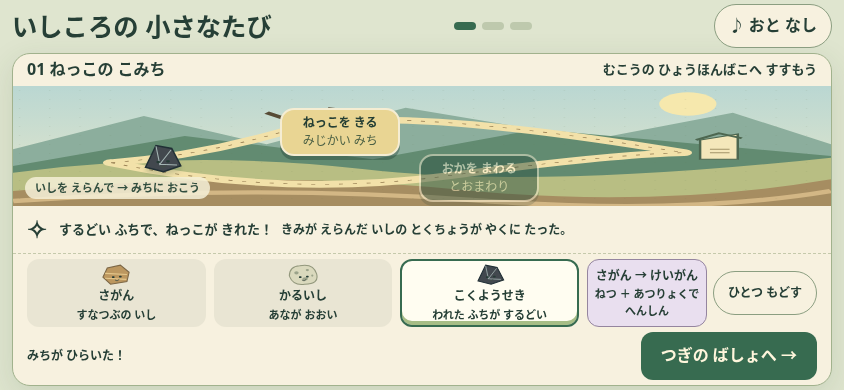
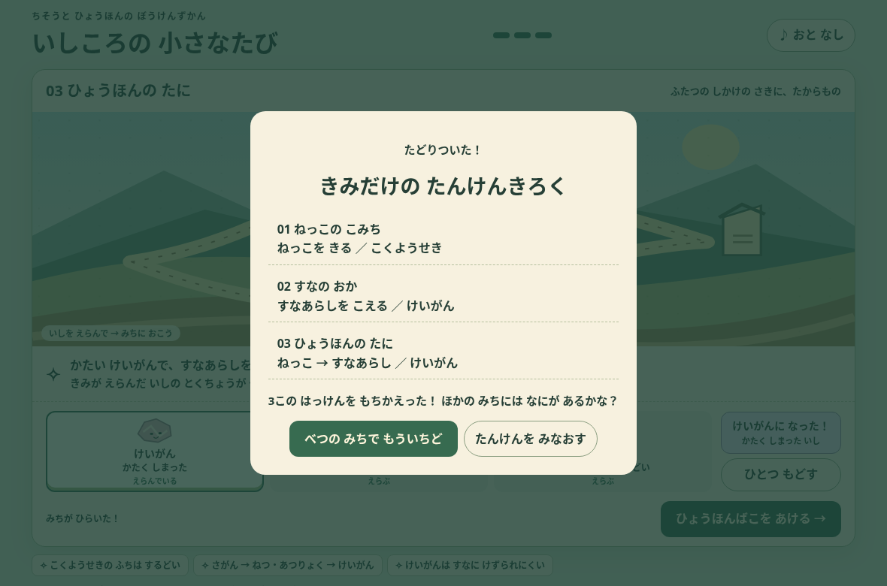

# いしころの小さなたび：形式を比べる試作

タワーディフェンスの操作を改善した版を残し、「石の性質を使って道をひらく」遊びを独立した1ファイルで試す。3分は目標の長さであり、人によるプレイ時間は未測定。

## 遊ぶ

`prototypes/adventure.html` をSafari等のブラウザで開く。通信・インストール・アカウントは不要。すべての絵・音・処理をこのファイルに収めている。ブラウザのファイル制限がある開発環境では、ローカルHTTPで配信して確認できる。

Xcodeでは同じ `Ishikoro.xcodeproj` を開き、起動項目を **IshikoroAdventure** にして⌘R。従来版は **Ishikoro** を選ぶ。試作用の引数はDebugビルドだけで有効で、Releaseでは従来のゲームが起動する。Apple SDKのないLinuxではXcodeビルド・実機確認は未実施。

## 何を比べるか

| 場所 | 性質を使う近道 | 別の解き方 |
| --- | --- | --- |
| ねっこのこみち | 黒曜石の鋭い割れ口で根を切る | 石を変えずに丘を回る |
| すなのおか | 砂岩を珪岩に変え、硬さを使って砂嵐を越える | 崖の陰で風を避ける |
| ひょうほんのたに | 黒曜石→珪岩と使い分け、2つの障害を越える | 谷を回り、化石の模様を発見する |

操作は石を選ぶ→道の場所を押す。失敗の理由をすぐ示し、失敗で石や進行を失わない。「ひとつもどす」で成功・変身も戻せる。最後に自分の道と発見の記録を見て、別ルートでもう一度遊べる。

元のゲームの石を使い、図鑑の方向性・9歳の原案を継承する。黒曜石は火山ガラスの鋭い割れ口、珪岩は主に石英からなる硬い変成岩、砂岩→珪岩は熱・圧力による変成という既存の性質を使う。黒曜石の「鋭さ」と「硬さ」を同じものとして扱わない。実際の変成は地下で長い時間をかけることを変身時に明示し、瞬時に起きる自然現象とは説明しない。根切り・移動・砂嵐の突破はゲームでの表現であり、物理シミュレーションではない。

軽石は穴の多い見た目を残し、好きな石で回り道をする選択に使える。この試作では浮力など追加の仕組みはまだ検証しない。

## 今回省いたもの

戦闘の時間経過、HP、資源の補充待ち、ガチャ、育成、タイムアタックは、この試作には入れない。まず「選んで使うだけで楽しいか」を見る。元のゲームからは削除しない。全てを作り替える判断は人による比較のあとにする。

試作は保存APIを使わず、終了・再読み込みで最初に戻る。`ishikoro.html`・`ishikoroSave2`・`ISHI1.`・版の置換行・元の石と敵の数値を変更しない。XcodeのDebug用起動先と同梱リソースだけを追加する。

## 起動設定の修正

Swiftの `#if DEBUG` は、構成の名前がDebugであるだけでは有効にならない。このプロジェクトで定義が欠けていたため、試作用Schemeでも従来版を開く状態だった。Debug構成に `SWIFT_ACTIVE_COMPILATION_CONDITIONS = "$(inherited) DEBUG"` を追加し、起動引数・Scheme・Debug定義のつながりを検証対象にした。Release構成は変更していない。

## 検証

```sh
python3 tools/check_adventure.py --screenshots /tmp/ishikoro-adventure
```

PC Chromiumのタッチ設定で844×390・1180×780・390×844を確認。各画面で近道と回り道の両方を最終地点まで操作し、失敗→再試行、成功の取り消し、変身の取り消し、ヒント、2段階の道、記録、再プレイを検証する。回転で現在地が消えないこと、全操作44px以上、既存保存値を保持すること、外部通信・JavaScript例外がないことも確認する。音は初期OFFで、操作による開始と中断通知でのAudioContext停止を確認する。復帰だけでは音を再生しない。

既存ゲームもPCブラウザで初期状態から第1戦をクリア（参考走行のゲーム内時間約37.2秒、JS例外0）。ゲーム本体は今回変更していない。Xcodeの共有SchemeのXML・プロトタイプの同梱参照・JavaScript構文も確認する。Swiftビルド、実機Safari/WKWebView、実際の操作感・音・fpsは未確認。





## 初見プレイヤーとの比較

大人が先に正解を教えず、従来版と試作版を順番を入れ替えて触ってもらう。

- 最初の30秒で自分から石を置くか。
- 失敗したとき、自分から石・変身・道のどれかを変えるか。
- 「なぜその石／道を選んだ？」を本人の言葉で説明できるか。
- 変身の意味を、実際の石の成り立ちと混同しないか。
- 図鑑を埋めたい、別の道を試したいと思うか。
- 「どちらをもう一度遊びたい？」と理由を聞く。読み物・正解当てに感じたかも聞く。

別ルートは戦術の比較を試すための小さな構成であり、長期的な深さを保証しない。回り道が毎回安全で単調、正解探しに感じる、軽石を選ぶ意味が弱い場合は、その観察を次の設計に反映する。
