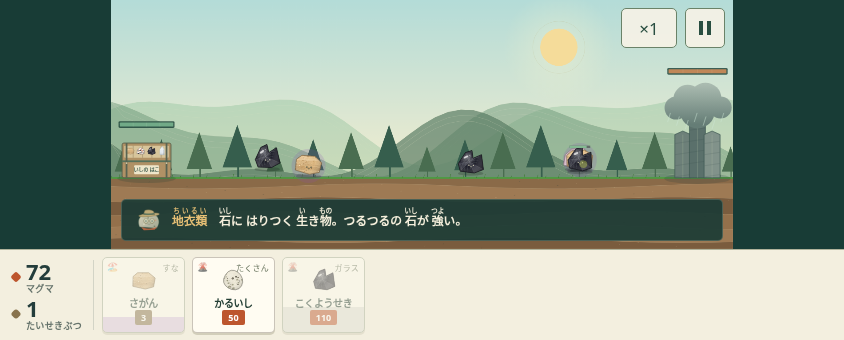
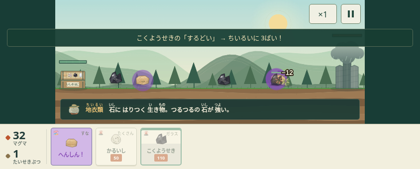

# 戦闘の手応え（第2PR）

第1PRを前提に、ダメージ・能力値・相性倍率・資源・敵の時刻は変えず、判断と結果の見え方を変える。

- 通常攻撃はダメージの数を表示。「ばつぐん」は数値と文字を併記する。
- 相性が効いたときは「石の名前・特徴・相手・倍率」を一行で示す。色だけには頼らない。固定のCSS文字サイズを使い、戦場の縮小で理由が読めなくなることを避ける。
- メッセージは一度に一つ、3.5秒。同じ組み合わせは8秒の間隔を空ける。危険と変身を優先し、敵の登場は相性の説明を隠さない優先度にする。
- 箱HPが35%以下になったときに一度だけピンチを案内する。ボスの既存の登場・撃破案内は維持する。
- 結果画面には実際に効いた相性、または城を最も削った石を表示する。敗北時は実際に仲間を倒した敵・箱を削った敵を記録し、使える石か変身先を具体的に勧める。対応する石がない場合も早めの出撃と既存のおたすけを案内する。
- 毒で倒れたときも毒を与えた相手を記録する。記録は一戦のメモリ内だけで、セーブ形式や外部通信を増やさない。
- 画面内の浮かぶ文字は既存の4個制限を維持し、描画エフェクトを64個に制限する。粒子のために攻撃や進行を止めない。音は既存の効果音を使用する。

変更前後：

| 変更前 | 変更後 |
| --- | --- |
|  |  |

PCブラウザの既存UI・最初の戦闘・各演出を確認した。相性の固定乱数の作戦比較に加え、勝敗の説明に実際の石・特徴・相手が表示されることを確認した。軽石だけの敗北では「地衣類に11個倒された→次は黒曜石」、対処した勝利では「黒曜石のするどいが地衣類に10回効いた」と実際の記録が表示された。iPhone実機での読み取りやすさ・振動・音の聞こえ方、低性能端末のfpsは未検証。人によるテストでは「なぜ効いたか」「次に何を変えるか」を本人の言葉で聞く。
