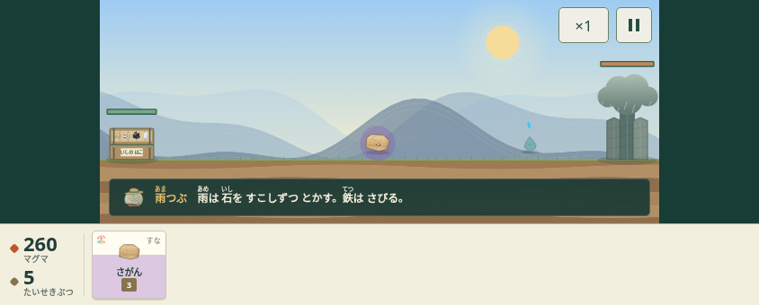
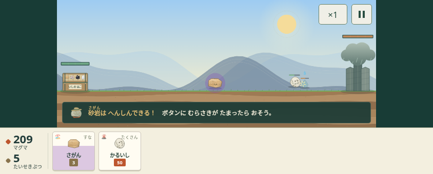

# 序盤の診断と検証計画

## 測り方

対象は main の `c440ea0`。PC版Chromiumに844×340のタッチ画面を設定し、空のlocalStorageから実際のDOMボタンを操作した。Playwrightの仮想時計を使用し、戦闘時間はゲーム内の `G.clock` を読み取った。計測用の読み取り関数はブラウザへ返すHTMLにだけ挿入し、リポジトリのゲームや計算式には加えていない。

これは子どものプレイ時間・理解度・楽しさの実測ではない。各ステージ1試行の参考走行であり、最適解の探索でもない。ボタンの自動待機や変身の停止時間があるため、テストのループ回数を実時間として扱わない。

## 変更前の診断

| 項目 | 実測・ソース確認 | 解釈・未確認事項 |
| --- | --- | --- |
| 最初の出撃 | おはなしを読む経路は13操作のあとに出撃1操作。スキップ経路は5操作のあとに出撃 | 読む時間と迷う時間は人によるテストが必要 |
| 第1戦 | 55.6秒、出撃7回、変身1回、ばつぐん0回、箱HP1500 | 石が1種類なので出撃の種類を選べない |
| 第2戦 | 77.1秒、出撃34回、変身0回、ばつぐん0回、箱HP1500 | 押せる石を反復する参考作戦でも無傷で突破 |
| 第3戦（内部ID16） | 65.1秒、出撃20回、変身3回、ばつぐん0回、箱HP1500 | 相性を使って勝った、という実感を作れていない可能性 |
| 待機 | 第1戦で、出撃数が増えない観測区間は計51.5秒 | 自動戦闘を見ている時間も含む。「退屈な時間」と同一視しない |
| 相性 | 雨と砂岩の計算は中立。画面の「雨に強い」という説明と不一致 | 説明文だけを信じても相性による成功にならない |
| 変身 | ボタンが出撃と変身を兼ねる。参考走行で第1戦1回、第3戦3回発動 | 偶然押した変身と意図した変身を区別できない。人の発言を観察する |
| 勝敗の説明 | 結果は時間・出撃数・ばつぐん回数。敗北は汎用おたすけ案内 | 「何が効いたか」「どの敵に負けたか」が具体的でない |
| 次のステージ | 結果画面が準備画面を覆い、出撃への実際のクリックが阻まれた | ステージ選択へ戻る経路で3戦目まで調査した |
| 仲間紹介 | `setTimeout(() => showGet([stageDef.reward]), 700)` が可変のステージを参照 | 遷移と競合する設計上の問題。同期した紹介順に置き換える |
| スマホの操作 | 出撃83×76px、石名10px、費用9px。一時停止40×40px | ボタン面積だけでなく、小さい意味表示が課題 |
| 縦画面 | 横長1400×560の戦場を画面幅で縮小する | 「このまま遊ぶ」の品質を保証できないため、UIの別PRで案内を改善する |

生の要約値は [baseline-metrics.json](review/baseline-metrics.json)。自動テストの成功は「もう1戦遊びたい」の証拠にはしない。

## 第1PR：最初の3戦

最初の1タップで戦場に入り、砂岩と軽石の2つだけを選べるようにする。おはなし・図鑑・既存チュートリアルは残す。第1戦の報酬を黒曜石にして、第2戦の植物へ使う理由を作る。第3戦は砂嵐と珪岩への変身の組み合わせを試す。

| 対象 | 変更前 | 変更後 | 理由 |
| --- | --- | --- | --- |
| 新規プレイの入口 | おはなし→地図→準備→遊び方→戦闘 | タイトル→戦闘。次の1タップで出撃 | 読む前に操作を体験できるようにする |
| 最初の仲間 | 砂岩1種 | 砂岩＋軽石の2種 | 別の資源を使う、じょうぶさと速さの比較。大量配布はしない |
| 第1戦の城HP | 1400 | 1100 | 最初の成功までの反復を短くする |
| 第1戦の雨 | 最初6秒、間隔6.5秒 | 最初4秒、間隔9秒 | 敵を早く見せ、最初の出撃を立て直せる間隔にする |
| 第1戦の報酬 | 軽石 | 黒曜石 | 軽石を最初の仲間へ移し、次の戦術を1種だけ紹介 |
| 第2戦の城HP | 2400 | 1800 | 相性を使った結果を短い戦闘で確認 |
| 第2戦の雨 | 間隔6秒 | 最初4秒、間隔14秒 | 中立の雨の物量より、植物への対処に焦点を置く |
| 第2戦の特別な敵 | 酸22/50/74秒、地衣類36/62秒 | 地衣類10/22/52秒、根34秒 | 黒曜石の「するどい」が植物に効く既存の計算を体験 |
| 第3戦の城HP | 2600 | 2200 | 変身による突破を冗長にしない |
| 第3戦の雨・特別な敵 | 雨7秒間隔、地衣類20/40秒、酸60秒 | 雨14秒間隔、砂嵐14/28/42/56秒 | 砂岩のすきまと、変身後の珪岩の硬さを比較 |
| 石の能力値・相性倍率 | 既存値 | 変更なし | 科学的な個性と後半のバランスを維持 |
| 4戦目以降・ガチャ解放 | 既存値 | 変更なし | 初回体験に範囲を限定 |

第2戦は「ねっこの森」として内容と名前を一致させる。石の原案・種類は変えない。黒曜石は火山ガラスの鋭い割れ口、砂岩→珪岩は熱と圧力による変成、軽石の速さは既存ゲーム内の性能に基づく。新しい科学的性質や相性ルールは追加しない。

既存セーブはリセットしない。旧第1戦をクリア済みで黒曜石を持たないデータには黒曜石Lv1を一度だけ補う。既存のレベル・進行・チケット・未知の項目は保持し、編成が6枠なら上書きしない。同じ補完をISHI1.の取り込みにも適用する。

## 第1PRの検証結果

既存の `python3 tools/check_game_ui.py --play --animations --screenshots /tmp/ishikoro-pr1-review` は完了。変更した入口に合わせ、既存テストの開始手順と、おはなし専用テストの入口だけを更新した。テストの大幅な追加は第4PRに分ける。

初期セーブから第1→第2→第3戦を進める参考走行では、42.5秒・51.1秒・45.9秒でクリア。第2・第3戦では相性によるばつぐんが4回・7回発生した。新しい入口の出撃は、タイトルの「たびにでる」と石のボタンの2操作で可能。これは操作数の確認であり、初見の子どもの30秒達成を意味しない。

同じセーブ・同じ固定乱数（713）で作戦を比較した。

| 場面 | 作戦 | 結果 | 戦闘時間 | 箱HP | ばつぐん |
| --- | --- | --- | --- | --- | --- |
| 第2戦 | 軽石だけを反復 | 敗北 | 119.1秒 | 0以下 | 0 |
| 第2戦 | 砂岩を前に、黒曜石を出す | 勝利 | 45.6秒 | 1500 | 8 |
| 第3戦 | 砂岩・軽石、変身しない | 敗北 | 68.9秒 | 0以下 | 0 |
| 第3戦 | 同じ2種類、変身を使う | 勝利 | 55.6秒 | 1500 | 10 |

単純な参考作戦での比較であり、唯一の勝ち方を強制したり、すべての作戦・乱数で同じ結果になると保証するものではない。数値は [opening-metrics.json](review/opening-metrics.json)。

旧セーブと旧ISHI1.コードの読み込みでは、進行・レベル・チケット・6枠の編成・未知の項目が残り、不足した黒曜石だけがLv1で補われることを確認した。次のステージへ実際にクリックして進み、第2・第3戦に出撃できた。遅延する仲間紹介は取り除き、紹介を閉じてから結果の次へを選ぶ順にした。

PCブラウザの確認であり、iPhone/iPadの実機、SafariとWKWebViewの音声・復帰は未確認。

変更前：

変更後：

## 別PRに分ける範囲

1. 序盤3戦、入口、報酬紹介と「次へ」の進行（このPR）。
2. 相性の理由、攻撃・危険・勝敗の手応え。能力値の再変更はしない。
3. 出撃・変身・資源・HPの優先順位、タッチ領域、縦画面、中断復帰。
4. 初期セーブの3戦、戦術比較、保存・遷移・中断の回帰テスト強化。

## 人によるテスト（初見の子ども3〜5人）

説明役は操作を教えず、本人の言葉と行動を記録する。保護者同席で、個人情報や録画をゲームに送信する仕組みは作らない。

| 観察 | 目安 | 記録すること |
| --- | --- | --- |
| 最初の操作 | 起動後30秒以内 | 自分で石を出せたか。何を押そうとしたか |
| 個性の理解 | 1分以内 | 「この石を選んだのはなぜ？」への本人の説明 |
| 最初の成功 | 3分程度まで | 自分の操作で勝ったと感じたか。どこで嬉しそうだったか |
| 戦術の変更 | 最初の10分 | 植物に黒曜石、砂嵐に変身等を自分で選び直したか |
| 負けたあと | 1回目の敗北時 | 理由と次に試す操作を本人が言えるか。おたすけを見つけられるか |
| 継続 | 第1戦・第3戦の終了時 | 誘導せずに「もう1ステージ」を選ぶか。やめた理由 |

30秒・1分・3分・10分は設計目標であり、現時点で人に対して達成済みとはしない。PCのタッチエミュレーションと、iPhone/iPad実機のタップ・音・回転・中断復帰・WKWebViewのセーブは別に記録する。
