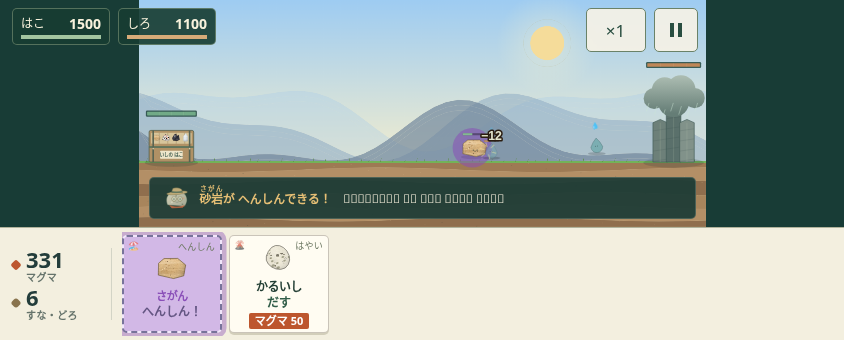
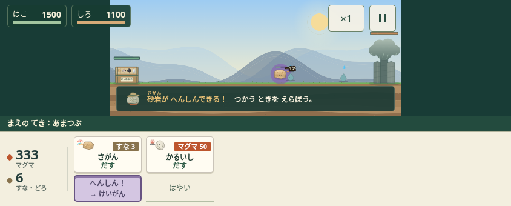
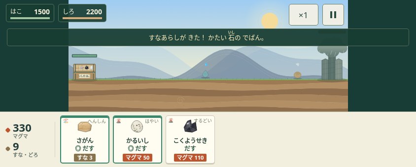
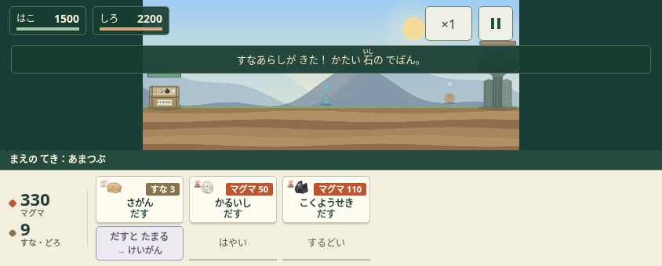

# 自分でタイミングを選ぶ戦闘

対象は前回の4つのPRを重ねた `e5562a8`。main（`c440ea0`）は変更せず、`improve/tactical-choices` で作業する。

## 判断と診断

このゲームの魅力の中心は「知っている石の性質が、勝つための工夫になる」こと。石や育成項目を増やす前に、出撃・変身・相性の表示を信用して操作できる状態を作る。

| 観察 | 実測・コードで確認した問題 | 今回の判断 |
| --- | --- | --- |
| 変身をためる | 第1戦で砂岩を出して15秒後、出撃ボタンが変身に置き換わる。追加出撃を選べない | 出撃と変身を別のボタンにする。温存・追加出撃・変身のタイミングを本人が決める |
| 相性の案内 | 第3戦で砂嵐の出現後、砂岩と軽石の両方が「◎」。攻撃倍率0.4も、有利を表すtruthyな値として扱われていた | 実際の戦闘倍率に合わせて表示を修正。準備画面・敵図鑑の同じ誤りも直す |
| 判断の対象 | どれか1体に有利なら緑になるため、手前の敵に効くか分からない | 箱に最も近い生きた敵の名前を表示し、その敵との相性を◎とくい／△にがてで示す |
| 敵への備え | 序盤の特別な敵は出現してから案内される | 第1〜3戦の確定した特別な敵を、8ゲーム秒前から1件予告する。ランダム出現や城HPによるボス出現は秒数を断言しない |
| 操作説明 | タッグを下へ移したあとも「左上」、変身も「同じボタン」の説明が残っている | 現在の配置に合わせる。説明の画面や手順を増やさない |

実測はPC Chromiumの仮想時計・DOM入力によるもの。子どもが予告に気づくか、温存が楽しいか、どちらの石を選ぶかは未測定。「敵が来る前に準備する楽しさにつながる」は設計上の仮説であり、自動テストの合格からは断定しない。

今回不要と判断したのは、新しい通貨・新しい石の大量配布・さらに長いチュートリアル・常時点滅するおすすめ表示。既存の図鑑・収集・物語・タッグ・育成を残して、操作の意味を整える。

## 実装

- 出撃は資源を払って石を追加する操作に固定する。変身がたまっていても追加出撃でき、変身ゲージは消費しない。
- 変身は石ごとの独立ボタン。変身先・残り秒数・使える状態・手前の敵との相性を示す。戦場に対象の石がいない、一時停止中、演出中、決着後は実行できない。
- 多段階の変身は、実際に戦場にいる進化先を追う。変身は従来どおり最前列の対象1個に作用する。出撃の待ち時間・資源不足・30体上限と変身の可否を混同しない。
- スマホでは出撃112×60px、変身112×44px。iPad相当では出撃138×118px、変身138×52px。6枠は横スクロールできる。変身先が長い場合は折り返す。
- 予告は戦闘時間を使うため、中断で止まる。1〜3戦の特別な敵のみが対象で、雨を含めた全出現順の一覧ではない。アイデアスイッチの「全部雨」では実際に出る雨を表示する。

| 項目 | 変更前 → 変更後 |
| --- | --- |
| 全ての石のHP・攻撃・費用・速度・変身所要時間 | 変更なし |
| 敵・ステージHP・出現時刻・報酬・難易度倍率 | 変更なし |
| 相性倍率 | 有利2.5倍／鋭い石対植物3倍、不利0.4倍の既存計算を維持 |
| 出撃と変身 | 兼用ボタン → 独立した操作。変身を温存した追加出撃が可能 |
| 保存 | `ishikoroSave2`・`ISHI1.`・保存項目の変更なし |
| 配布版 | `EDITION`・`PASS_HASH`・`SHOP_URL`・`TRIAL_LAST` の行の変更なし |

砂岩→珪岩などの既存の変成と、鋭い割れ口・硬さ・すきまの既存の相性を使う。新しい科学的な性質や攻撃ルールは追加していない。

## 画面

同じ操作で第1戦の砂岩を出し、15秒進めた画面。変更後は砂岩の追加出撃と珪岩への変身を別々に選べる。

| 変更前 | 変更後 |
| --- | --- |
|  |  |

第3戦、砂嵐の出現後。変更前は不利な石も◎になる。変更後は「まえのてき」との関係を示す。この時点で先頭にいる雨粒との相性は中立なので、砂岩と軽石に◎を出さない。

| 変更前 | 変更後 |
| --- | --- |
|  |  |

## 検証と実際のプレイヤーで見ること

`python3 tools/check_game_ui.py --play --animations --screenshots /tmp/ishikoro-tactics-final`

従来の9ケースに、温存→追加出撃→変身・予告の中断・6枠のタッチ面の2グループを加えた。戦闘の自動操作も独立した変身ボタンを使う。変身なしの作戦でも、ゲージがたまったあとに出撃を続ける（旧操作ではそれができなかった）。参考走行の勝敗・時間は [tactical-metrics.json](review/tactical-metrics.json) に記録した。指定コマンドは終了コード0で完了し、11ケース、既存の4画面サイズ・57標本・図鑑各タブ・発見／変身／タッグ／いしほりの演出を通過した。

初期3戦は約36.1秒・51.8秒・48.1秒でクリア。第2戦は軽石だけでは112.4秒で敗北、砂岩＋黒曜石では47.6秒で勝利。第3戦は砂岩＋軽石で変身なしなら72.5秒で敗北、変身ありなら55.3秒で勝利した。いずれもゲーム内時計による固定乱数の参考作戦で、人のプレイ時間や楽しさの測定ではない。

追加の操作確認では、頁岩→粘板岩→千枚岩の多段階変身が実際のボタンで進むことと、砂嵐の敵図鑑で同じ石が得意・苦手の両方に並ばないことを確認した。

PCのタッチ設定で667×300、844×340、1180×780の各ボタンが44px以上で、スクロール後に画面内に収まり、別の要素に覆われていないことを確認する。iPhone/iPad実機・Safari/WKWebView・実機fpsは別途確認が必要。元からある配布スクリプトは `/home/claude/web` 固定パスのため、この環境ではそのまま実行できない（Xcodeでは使用しない）。版の置換行は比較で保持を確認する。

初見プレイヤーには操作を先に教えず、第2戦・第3戦で次を観察する。

1. 予告を見てマグマや変身を残すか。「何に備えている？」と本人に聞く。
2. 変身が使える状態で、追加出撃と変身を押し分けられるか。
3. 「なぜこの石を選んだ？」の説明が、実際の相性・結果と合っているか。
4. 自分で工夫して勝ったと感じ、もう1戦を自分から選ぶか。

見た目の派手さやクリア率だけで成功としない。予告を読めない、操作が増えて迷う、石が小さく見える場合は、実機で戦場面積と操作面の配分を再調整する。
