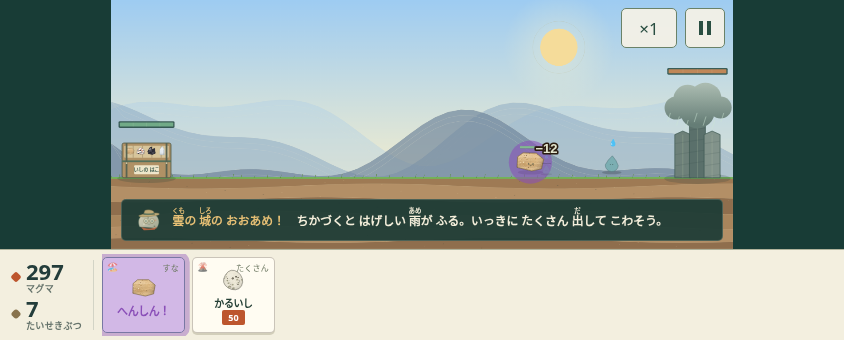
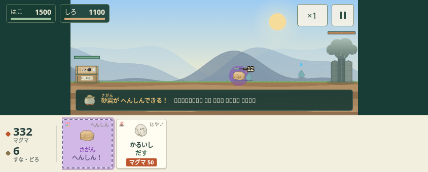

# 出撃と再開の操作（第3PR）

第2PRを前提に、石や敵の計算式は変えず、操作の見え方と中断復帰を修正する。

- 石名は常に残し、別の行に「だす／◎だす／へんしん！／待ち秒数／不足数」を表示。費用にも資源名を付ける。変身・相性・危険を色だけで伝えない。
- 小さい横画面で石名を10→12px、費用を9→11px、出撃面を83×76→100×98pxへ。一時停止・速度・再開は44px以上。iPadは出撃124×138pxで名前14px。
- 箱と城のHPを画面に固定した数字・バーで表示。危険時は文字と破線を付ける。理由のメッセージと同時に説明・バナーを重ねない。
- タッグは戦場の上でHPに重ねず、出撃バーの専用ボタンとして表示する。
- 縦向きでは図鑑を読むことはできるが、縮小した戦闘を遊べると案内しない。戦闘中の回転は一時停止。仲間紹介中は次のステージの操作を受け付けない。図鑑を往復しても、途中の変身やタッグの演出を捨てない。
- ブラウザのvisibility/pagehideと、SwiftUIのscenePhaseからのWKWebView通知の両方で中断を扱う。戦闘だけでなく変身中も時計を止め、WebAudioを停止・サスペンド。復帰は自動再生せず、プレイヤーの「つづける」を待つ。
- いしほりの遅れた仲間紹介も、同じ画面・同じ抽選のままである場合にだけ表示し、別の画面へ戻ったあとに割り込ませない。報酬の保存は従来通り。

| 変更前 | 変更後 |
| --- | --- |
|  |  |

旧ISHI1.コードの取り込み直後、欠けた星・発見情報などの初期値が補われず地図で例外になる不具合も再現した。読み込みと取り込みを同じ補完処理に統一し、取り込みの準備が成功する前に現在のデータを消さないようにした。

## 検証

PC版Chromiumのタッチ設定で、667×300・844×340・1024×724・1180×780の画面、初期プレイ、既存セーブ、図鑑・編成・各演出を確認した。

専用の中断テストでは、WebAudioの実際のstateがsuspendedになること、変身中にバックグラウンド通知を送っても戦闘時計・演出時計が動かないこと、復帰だけでは進まずタップで再開することを確認。縦画面への回転→図鑑→元の戦闘→横画面→再開と、ブラウザvisibilitychangeによる中断も確認した。

ネイティブの通知と同じイベントをブラウザへ送る確認であり、iOS実機の確認ではない。Xcode/Apple SDKがないためSwiftのビルドは未実施。Macでビルドし、iPhone/iPad実機のホーム画面・コントロールセンター・電話等の割り込み、音声の再開、回転、WKWebViewの保存を確認する必要がある。
